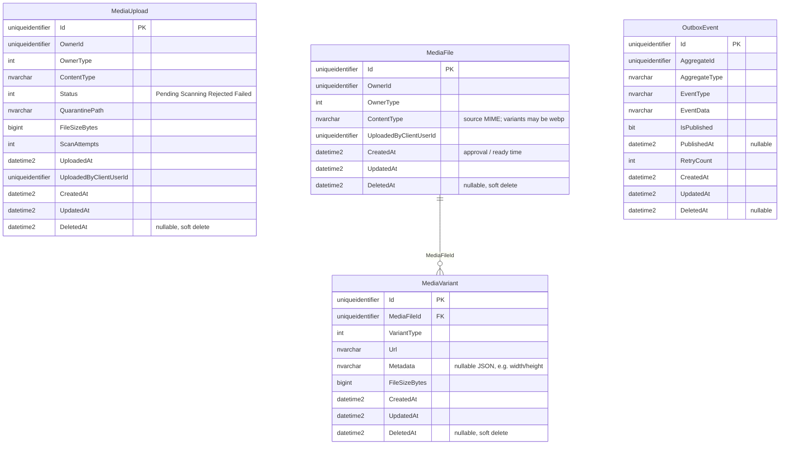

# Media database schema

SQL Server schema for the Media bounded context (`MediaDbContext`). Source of truth: EF Core configurations under `../Configurations/` and migrations under `../Migrations/`. Index name constants live beside this file.

## Entity-relationship diagram



## Tables

| Table | Role |
|-------|------|
| `MediaUpload` | Ephemeral quarantine upload (Pending/Scanning/Rejected/Failed) |
| `MediaFile` | Durable ready media after approval (same Id as the upload) |
| `MediaPolicy` | Upload rules per owner type |
| `MediaVariant` | Derived variants such as thumbnails or transformed assets |
| `OutboxEvent` | SharedKernel transactional outbox |

### Relationships

- **`MediaVariant.MediaFileId` -> `MediaFile.Id`** - required FK with cascade delete (ready media only).
- **`OwnerId`** is a logical polymorphic reference to the owning entity in another bounded context.
- On approve, a `MediaFile` is inserted with the upload's Id and the `MediaUpload` row is hard-deleted.
- Access (public/private) comes from `MediaPolicy` for the file's `OwnerType` — not stored on `MediaFile`.
- Ready file size lives on `MediaVariant` (`Original`); `ContentType` stays on `MediaFile` (source MIME); `UploadedByClientUserId` is copied Upload → File.

### Soft delete

`MediaFile`, `MediaUpload`, `MediaPolicy`, `MediaVariant`, and `OutboxEvent` use `DeletedAt` soft-delete timestamps. Approve uses hard-delete for the promoted `MediaUpload` row.

## Indexes

| Index | Columns | Notes |
|-------|---------|-------|
| `IX_MediaFile_OwnerId` | `OwnerId` | Owner lookup |
| `IX_MediaFile_OwnerId_OwnerType` | (`OwnerId`, `OwnerType`) | Polymorphic owner lookup |
| `IX_MediaUpload_OwnerId` | `OwnerId` | Owner lookup |
| `IX_MediaUpload_OwnerId_OwnerType` | (`OwnerId`, `OwnerType`) | Polymorphic owner lookup |
| `IX_MediaUpload_Status` | `Status` | Scan/approval workflow |
| `IX_MediaPolicy_OwnerType` | `OwnerType` UNIQUE | One policy per owner type |
| `IX_MediaVariant_MediaFileId` | `MediaFileId` | Variant traversal |
| `UX_MediaVariant_MediaFileId_VariantType` | (`MediaFileId`, `VariantType`) UNIQUE | One variant per type |
| `IX_MediaVariant_MetadataWidth` | computed `MetadataWidth` | Persisted computed; image width from JSON |
| `IX_MediaVariant_MetadataHeight` | computed `MetadataHeight` | Persisted computed; image height from JSON |
| `IX_OutboxEvent_AggregateId` | `AggregateId` | Outbox lookup |
| `IX_OutboxEvent_IsPublished` | `IsPublished` | Publish workers |
| `IX_OutboxEvent_Unpublished` | (`IsPublished`, `RetryCount`, `CreatedAt`) | Unpublished queue |

All index names are centralized in `MediaConstraints.cs`.

## Migrations & seed

```powershell
# From repo root
dotnet tool run api-scripts -- seed --service .
```

Seed data (`scripts/seeding/seed-database.sql`) loads default `MediaPolicy` rows by owner type.
